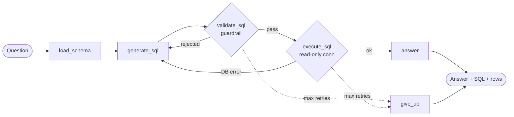

# Safe Text-to-SQL Agent


A LangGraph agent that turns natural-language questions into SQL, **validates every query before it touches the database**, self-corrects on errors, and streams each reasoning step to the client over WebSocket.

Runs on the public [Chinook](https://github.com/lerocha/chinook-database) music-store database and works with any OpenAI-compatible LLM (OpenAI, Azure OpenAI, Groq, Ollama).

<!-- Record a short GIF of the UI at http://localhost:8000 and replace this line:
 -->

## Why

LLM-generated SQL is untrusted input. A prompt that says "only write SELECT queries" is not a security boundary. This project treats the model's output the way you'd treat user input: parse it, check it against an allowlist, and enforce limits in code.

## Architecture



## Defense in depth

| Layer | What it does |
|---|---|
| **AST guardrail** (`sqlglot`) | Parses SQL into a syntax tree. Rejects anything that isn't a single `SELECT`/`WITH`/`UNION` query, and blocks `INSERT`, `UPDATE`, `DELETE`, `DROP`, `ALTER`, `PRAGMA`, `ATTACH`, etc. anywhere in the tree, including subqueries. |
| **Table allowlist** | Every referenced table must exist in the schema (CTE names allowed). Hallucinated tables are rejected before execution. |
| **Row limit** | Adds `LIMIT` when missing and caps oversized limits, so one bad query can't dump the database. |
| **Read-only connection** | SQLite opened with `mode=ro`. Even if the guardrail were bypassed, writes fail at the driver level. |
| **Bounded retries** | Guardrail and DB errors are fed back to the LLM for self-correction, up to `MAX_RETRIES`, then the agent gives up cleanly. |

## Quickstart

### Docker

```bash
cp .env.example .env        # add your LLM key (Groq free tier works)
docker compose up --build
```

Open http://localhost:8000.

### Local

```bash
python -m venv .venv && source .venv/bin/activate
pip install -r requirements-dev.txt
python scripts/download_db.py
cp .env.example .env        # add your LLM key
uvicorn app.main:app --reload
```

## API

**REST:** one-shot query

```bash
curl -X POST localhost:8000/query \
  -H "Content-Type: application/json" \
  -d '{"question": "Top 5 artists by number of tracks"}'
```

```json
{
  "question": "Top 5 artists by number of tracks",
  "sql": "SELECT ar.Name, COUNT(t.TrackId) AS tracks FROM Artist AS ar JOIN Album AS al ... LIMIT 5",
  "answer": "Iron Maiden leads with 213 tracks, followed by U2 (135) ...",
  "columns": ["Name", "tracks"],
  "rows": [["Iron Maiden", 213], ["U2", 135], ["Led Zeppelin", 114], ["Metallica", 112], ["Lost", 92]],
  "attempts": 1
}
```

**WebSocket:** `ws://localhost:8000/ws/query`. Send `{"question": "..."}` and receive one event per graph step (`load_schema`, `generate_sql`, `validate_sql`, `execute_sql`, `answer`), then `{"type": "done"}`.

## Tests

```bash
pytest -q
```

26 tests covering the guardrail (allowed and rejected queries, limit enforcement), the agent graph (happy path, retry after guardrail rejection, retry after DB error, give-up after max retries) and the API (REST, validation, WebSocket streaming). Tests use a fake LLM, so CI needs no API key.

## Project structure

```
app/
  agent.py       LangGraph state graph and prompts
  guardrail.py   sqlglot-based SQL validation
  db.py          read-only SQLite access and schema extraction
  main.py        FastAPI REST + WebSocket endpoints
  config.py      settings from environment
  static/        minimal demo UI
tests/           pytest suite with fake LLM
scripts/         Chinook download
```

## Design decisions

- **Code-block extraction over structured output.** Asking for a ```` ```sql ```` block works across every OpenAI-compatible provider, including small local models that handle JSON-mode poorly.
- **Errors go back to the model.** The guardrail's rejection message is part of the retry prompt, so the model learns *why* the query failed instead of guessing.
- **Schema with foreign keys.** The prompt includes FK relationships, which noticeably improves join accuracy compared to columns alone.
- **Streaming graph updates, not tokens.** Users see the agent's steps (generated SQL, guardrail verdict, results) as they happen, which builds trust in the answer.

## Roadmap

- [ ] Human-in-the-loop approval for expensive queries (LangGraph `interrupt`)
- [ ] Policy-as-code authorization with Cedar (`cedarpy`)
- [ ] PostgreSQL support
- [ ] Evaluation set with execution accuracy metrics

## License

MIT
